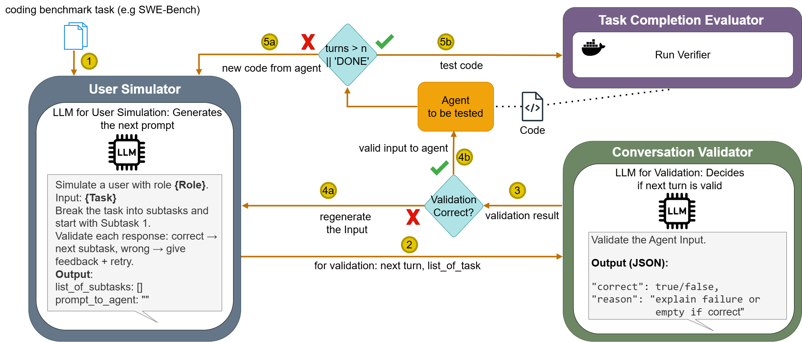

# SWE-DIVE: Multi-Turn Coding Agent Evaluation with Dynamic User Simulation

This repository contains the code and datasets accompanying the paper SWE-DIVE: Multi-Turn Coding Agent Evaluation with Dynamic User Simulation.

SWE-DIVE is a benchmark for evaluating coding agents in multi-turn software engineering interactions. SWE-DIVE simulates an interactive user who can provide feedback, clarification, and additional information throughout the task.

SWE-DIVE is integrated with Harbor and runs coding-agent evaluations inside isolated Harbor sandboxes. Rather than introducing a new set of software engineering tasks, SWE-DIVE builds on existing tasks integrated into Harbor, such as SWE-Bench, and extends their evaluation to multi-turn interactions with users.
<p align="center">
  
</p>


## Install

```bash
curl -LsSf https://astral.sh/uv/install.sh | sh   # uv
uv tool install harbor                             # Harbor (kept out of the project venv)
uv sync                                             # project dependencies
```

Requires Python ≥ 3.12 and a running Docker daemon (Harbor uses it for sandboxes).

Set credentials as environment variables (or copy `sample.env` to `.env`) — an LLM provider key (`OPENAI_API_KEY`, `ANTHROPIC_API_KEY`, `GOOGLE_API_KEY`, …) and, for the ACP-based agents, `COPILOT_GITHUB_TOKEN`.

## Running a job

```bash
uv run --with harbor main.py -c jobs/swebench-opencode.yaml
```

`--with harbor` injects the `uv`-tool-installed Harbor SDK into the run without adding it as a project dependency. Results are written to `jobs/<job_name>/`.

### Setting up a job YAML

```yaml
datasets:
  - name: swe-bench/swe-bench-verified
    task_names: [swe-bench/astropy__astropy-12907]   # or n_tasks: 5 for a random sample

agents:
  - name: swe-dive-user-sim-acp/opencode
    import_path: swe_dive.harbor_agents.user_sim_agent:UserSimAcpAgent
    kwargs:
      registry_spec: "acp:opencode"      # or UserSimOpenHandsAgent, no registry_spec needed
      persona: MIND_CHANGER              # EXPERT_NITPICKER | Vague_Requester | MIND_CHANGER | BASE_MODE
      coding_mode: COLLABORATIVE         # COLLABORATIVE | VIBE_CODING
      max_turns: 10
      sim_model: gemini/gemini-3.6-flash
      validation_model: gemini/gemini-2.5-flash-lite
      agent_model: gemini/gemini-2.5-flash

n_concurrent_trials: 4
```

Any field can be overridden from the CLI, e.g. `--persona`, `--max-turns`, `--job-name`, `--debug`. See `jobs/swebench-{opencode,openhands,copilot,pi}.yaml` for one working config per coding-agent backend.

## The 6 paper jobs

`jobs/` accumulates every run made during development; the results reported in the paper live in six of these directories, named by persona:

| Jobs | Trials | Section |
|---|---|---|
| `*_expert_nitpicker`, `*_vaguerequester`, `*_mindchanger` | Atropy 12907 | §4.1 — qualitative trajectory analysis |
| `*_expert_nitpicker_10runs`, `*_mindchanger_10runs`, `*_vaguerequester_10turns` | 10 sample runs each | §4.2 |


## Output layout

```
jobs/<job_name>/<task>__<trial_id>/
├── config.json              # trial config (agent kwargs, model, …)
├── result.json               # reward, timing, exceptions
├── agent/
│   ├── conversation.json     # multi-turn user↔agent log
│   ├── trajectory.json       # ATIF trajectory (viewable in `harbor view`)
│   └── orchestrator.txt      # in-container run log
└── verifier/
    ├── reward.txt             # 1 = resolved, 0 = unresolved
    └── test-stdout.txt        # pytest output
```

Browse any job with:

```bash
harbor view jobs/
```

## Project structure

```
main.py                    # Harbor SDK entry point (Job.create / job.run)
jobs/                       # job configs (*.yaml) and results (see above)
swe_dive/
├── sandbox/                # runs inside the Harbor container
│   ├── user_sim/            # simulator, personas, prompts, validators
│   ├── coding_agents/       # OpenHands / ACP backends
│   └── orchestrator.py      # in-container entrypoint
├── harbor_agents/           # host-side Harbor agent classes
└── adapters/                # benchmark → Harbor task directory adapters
analysis/                    # Scripts for collecting, processing, and analyzing raw data
tests/                      # offline unit tests
```
